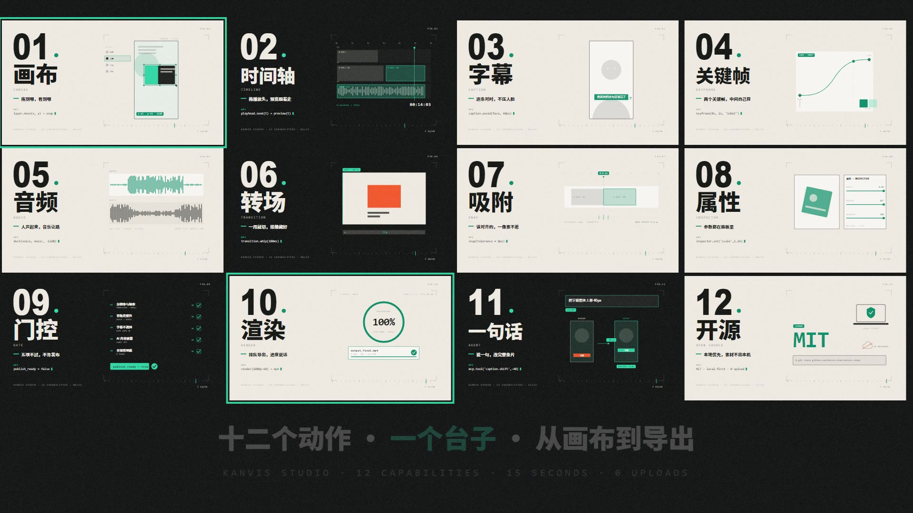
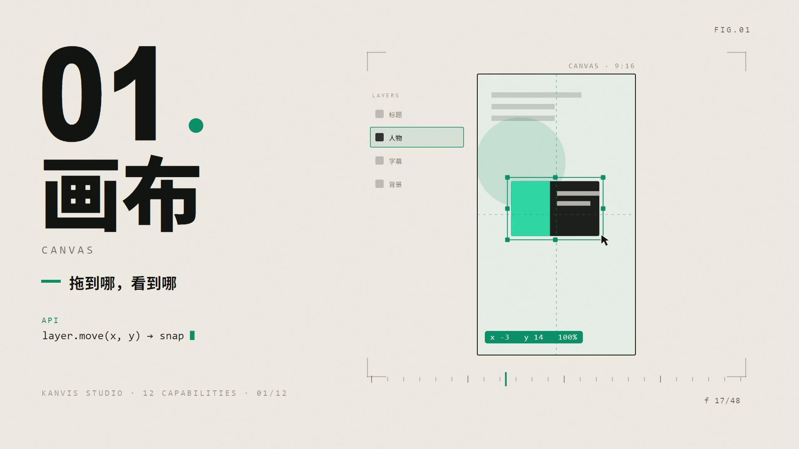

# card-film

**十二卡点短片生成器。** 给一个主题、产品或一篇长文，产出一条 15 秒、横竖双版、画面全部由 Canvas 逐帧算出来的卡片式动效短片。

12 张卡 = 12 个动作，切点踩在音乐重音上，零素材、零录屏、零 AI 生图。改 4 个配置块，3 分钟出一条。

<p align="center">
  
</p>

▶ **看片**：[横版 16:9](assets/demo-16x9.mp4)（1280×720 / 1.6 MB） · [竖版 9:16](assets/demo-9x16.mp4)（608×1080 / 955 KB）

---

## 一条片子的规格

| | |
|---|---|
| 时长 | 15.1 s / 906 帧 |
| 画幅 | 1920×1080 与 1080×1920，同一份代码出两版 |
| 帧率 | 60 fps |
| 编码 | H.264 High / CRF 16 / yuv420p / `+faststart`；AAC 192k 48kHz |
| 结构 | 开场钩子 0.4s → 标题 0.4s → **12 张卡**（约 7.6s）→ 十二宫格总览 2.0s → 落版 1.9s |
| 素材 | 无。每一个像素都是代码画的 |
| 渲染耗时 | 单版约 95s，双版约 3.5 分钟 |

## 为什么是纯代码

每一帧由 `window.renderAt(t)` 从时间 `t` 现算，不依赖播放进度、不依赖浏览器实际帧率。所以：

- **确定性**：同一个 `t` 永远得到同一帧。改一个字重渲，其余部分逐像素不变（可以用 PSNR 验证）。
- **可 diff**：片子是文本。文案、配色、节奏都在 HTML 里，能进版本库、能 review。
- **可批量**：横竖双版共用一套舞台坐标，竖版只多一次 `ctx.scale`，不做二次剪辑。

## 安装

```bash
git clone https://github.com/Kanvis-chen/card-film.git ~/.workbuddy/skills/card-film
cd ~/.workbuddy/skills/card-film
npm i puppeteer-core
```

依赖：

- **Node ≥ 18**
- **puppeteer-core**（上面那条命令装好）＋ 本机已安装的 Edge / Chrome（脚本会自动探测，可用 `BROWSER=<path>` 覆盖）
- **ffmpeg / ffprobe** 在 PATH 里
- **Python 3.11+**（只有 `scripts/bgm.py` 合成配乐需要 `numpy` + `scipy`）

如果你用的是 WorkBuddy / Claude Code 这类带 skill 目录的 agent，把它放进对应 skills 目录即可，触发词 `/cardfilm`、「卡点片」「十二卡」。

## 三分钟出一条

```bash
cd ~/.workbuddy/skills/card-film

# 1) 改 templates/film.html 顶部的四个 EDIT ZONE（颜色 / 文案 / 12 张卡 / 切点）

# 2) 抽几帧看版式（2 秒出图，不要靠肉眼估）
node templates/batch.js templates/film.html h "1.2,5.9,11.9,14.9" out/qa
python scripts/probe.py out/qa/h_1.20.png 60 760 dark 0.72

# 3) 出片：横竖双版 + 封面 + 联系表
python scripts/build.py --html templates/film.html --audio music.wav --name MyFilm --dur 15.1
```

`--res h` / `--res v` 只出单版。产物在 `out/`。

没有可用的授权音乐时，先合成一条自有版：

```bash
python scripts/bgm.py out/bgm.wav      # 150 BPM，切点带 tick，无版权风险
```

## 四个 EDIT ZONE

`templates/film.html` 顶部，只改这四块，绘制逻辑一律不动。

| ZONE | 改什么 |
|---|---|
| 1 `COL` | 六色：纸色、墨色、强调色、警示色，以及浅底用的两个深色变体 |
| 2 `CFG` | 品牌名、产品名、开场钩子、总览标题、落版主张、标语、链接 |
| 3 `CARDS` | 12 张卡的 `n / cn / en / sub / atoms / api / dark / demo` |
| 4 `CUTS` | 13 个切点（12 张卡的边界），以及 `TL.grid` / `TL.final` |

`api` 必须是这一页演示的「命令」，不是营销词。写「画布」就要配一个真的在拖动的图层，不能配一段发光文字。

## 十二个演示原语

模板里现成 12 个，每个都写成 `dNN(u)`，`u` 是这张卡内的归一化进度。可以换语义，不必换实现。

| | 原语 | 动作 | 可以换成 |
|---|---|---|---|
| d01 | 拖拽 + 吸附 + 缩放 | 图层被拖、吸附中线、右下角拉大，读数跟着变 | 任何「摆放 / 调整」类操作 |
| d02 | 横扫播放头 | 三轨时间轴，播放头扫过、当前片段高亮 | 任何「随时间推进」的过程 |
| d03 | 先错后对 | 元素压住人脸报警，再跳到安全区打勾 | 任何「纠错」叙事 |
| d04 | 曲线驱动 | 缓动曲线 + 曲线上的点，下方方块同步被驱动 | 任何「参数 → 结果」的因果 |
| d05 | 让路 | 人声起、音乐自动降，两轨电平对比 | 任何「优先级 / 避让」 |
| d06 | 甩切 | 横向甩镜，速度线遮住接缝 | 任何「切换 / 过渡」 |
| d07 | 磁吸对齐 | 读数 24.0px → 0.0px，容差区间高亮 | 任何「精确 / 达标」 |
| d08 | 滑杆驱动 | 三个滑杆推着预览里的方块 | 任何「调参」 |
| d09 | 逐项通过 | 五项打勾，最后盖章由红转绿 | 任何「审核 / 合规 / 发布」 |
| d10 | 进度环 | 进度环 + 帧计数 + 输出文件卡 | 任何「执行 / 生成」 |
| d11 | 一句话改写 | 输入一句话，BEFORE / AFTER 两屏对比 | 任何「AI / 自动化」 |
| d12 | 盖章收尾 | 许可证、带锁的本地机器、被划掉的云 | 任何「信任 / 边界」 |

新增原语照现有函数写：只用 `ball / rr / txt / chip / dashLine / groundLine / hatch / playhead` 这些助手，坐标系是**舞台坐标**（横版 883..1792 × 126..906），竖版由一次 `ctx.scale` 自动映射 —— 不要写屏幕绝对坐标。

## 版式锚点（横版 1920×1080）

| 元素 | 位置 |
|---|---|
| 编号 | x=91，基线 338，字面宽压到 326 |
| 中文标题 | x=96，基线 540，2 字 196 / 3 字 158 |
| 英文小标 | x=100，y=610，字距 6.8 |
| 副标 | x=166，y=695（前面短横 x=99、y=673） |
| 代码行 | 标签 `ATOMS` y=777，正文 x=101 / y=816 |
| 页脚 | x=100，y=952，字距 4.2 |
| 演示舞台 | 883..1792 × 126..906，中心 x=1337，地平线 y=773 |
| 刻度条 | 893..1780，y=912 |

竖版另有一套 `LAY_V`：编号基线 420、标题 630、舞台 64..1016 × 812..1588、刻度 1752。

<p align="center">
  
</p>

## 目录

```
SKILL.md                给 agent 读的操作手册（风格锁 + 5 个 Phase + 自检清单）
templates/film.html     完整渲染器（改四个 EDIT ZONE 即可换主题）
templates/render.js     逐帧出图（puppeteer-core + 无头 Edge/Chrome）
templates/batch.js      抽单帧预览
scripts/cuts.py         测切点 / 测重音 / 生成 CUTS 建议
scripts/build.py        渲染 + 合音 + 封面 + 联系表，一条命令
scripts/bgm.py          合成 150 BPM 自有版权配乐
scripts/probe.py        像素投影量版式（行 / 列）
references/style.md     视觉规范细则
references/cards.md     十二卡文案写法
references/pipeline.md  技术管线与环境坑（九个坑）
```

## 常见错误

| 症状 | 原因 |
|---|---|
| 数字宽度和参考片对不上 | Arial Black 比原字体宽约 18%，必须 `fitText()` 压到目标宽度，不能改字号 |
| 卡切换时文字叠在一起 | 左栏擦入没做 clip，或擦入时长超过切点间隔 |
| 总览页标题压在飞入的卡片上 | 标题淡入早于卡片归位，把 `ca` 起点推到 0.44 之后 |
| 某张卡看着空 | 演示元素全挤在舞台中间一小块，按舞台可用区重排 |
| 成片比预期长 / 短 | `CUTS` 末值 ≠ `--dur`，或旧帧没清（用 `-frames:v` 精确截断） |
| 鼓点总是差半拍 | 用了等间隔切点配不规则重音，回 Phase 1 用 `cuts.py` 重测 |
| 竖版跑偏 | 演示里写了屏幕绝对坐标，应该用舞台坐标 |

## 关于音乐

仓库不带音频。`scripts/bgm.py` 能合成一条自有版权的 150 BPM 配乐；换成曲库音乐时注意授权 —— 商业素材被投诉的成本远高于换一首曲子。

## 风格锁：这五条不要改

1. **左栏锚点 + 右栏演示**，五层固定：编号、中文标题、英文小标、一句人话、代码行。
2. **12 张卡，深色卡每 4 张出现一次**（第 2 / 6 / 9 / 11 张）—— 深色是拍子，不是装饰。
3. **每张卡的演示必须真的在动**，且和标题说的是同一件事。演示是证据，不是背景。
4. **切点踩在音乐上**。等间隔铺 12 张卡是这类片子最常见的失败。
5. **收尾是一句主张**，前半句品牌色、后半句米白。不要写「谢谢观看」。

---

## English

A beat-locked 12-card short-film generator. Pure procedural canvas: every frame is computed from `t` by `window.renderAt(t)`, so output is deterministic and diffable. One HTML file renders both 16:9 and 9:16. 15.1s / 60fps / 906 frames, edited to musical onsets.

```bash
git clone https://github.com/Kanvis-chen/card-film.git
cd card-film && npm i puppeteer-core
python scripts/build.py --html templates/film.html --audio music.wav --name MyFilm --dur 15.1
```

Requires Node ≥ 18, ffmpeg, and a local Edge/Chrome. Edit the four zones (`COL` / `CFG` / `CARDS` / `CUTS`) at the top of `templates/film.html` to change theme.

## License

MIT © 2026 Kanvis-chen. Demo footage was produced with [Kanvis Studio](https://github.com/Kanvis-chen/kanvis-studio).
